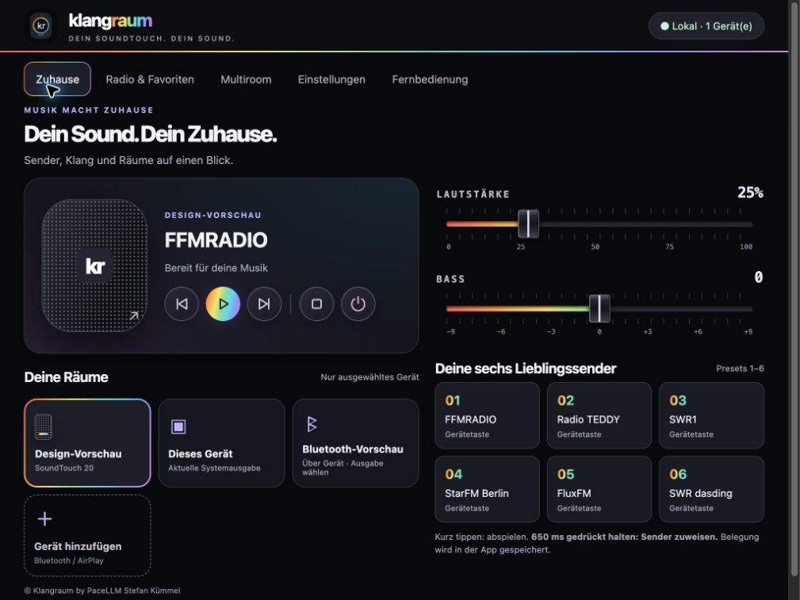
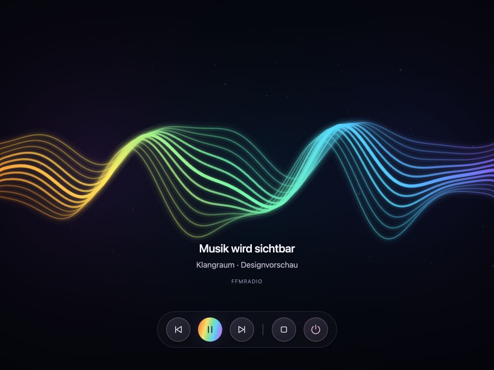
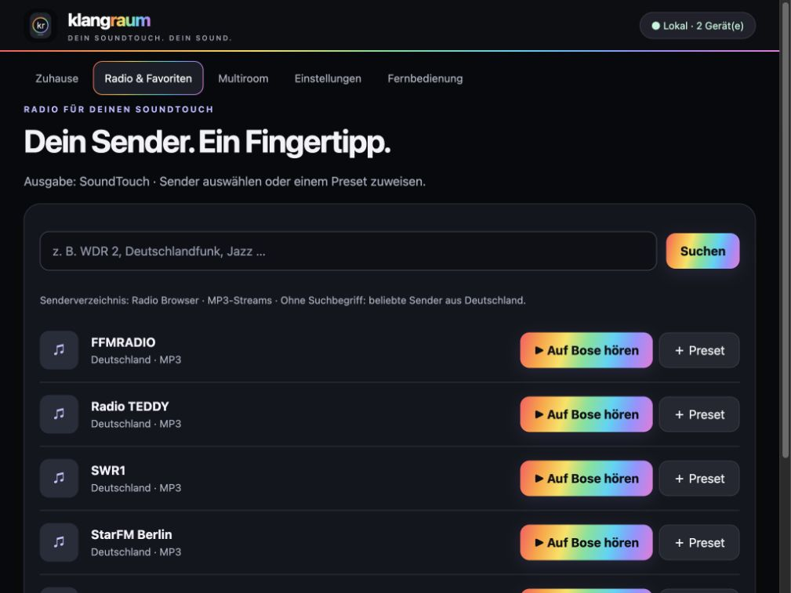
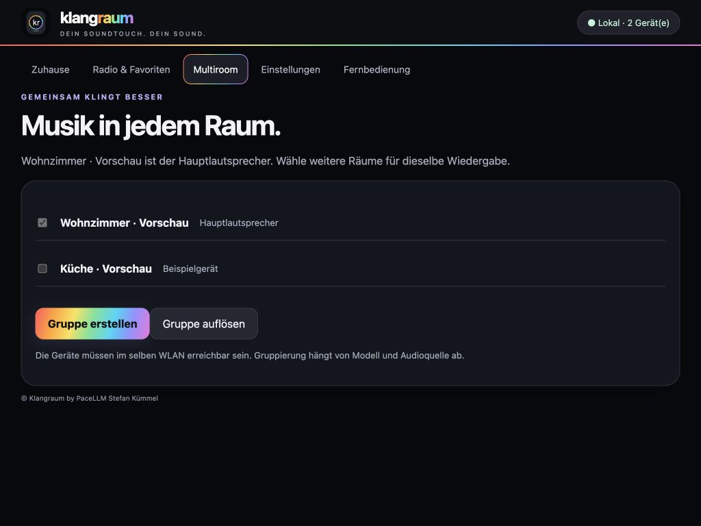
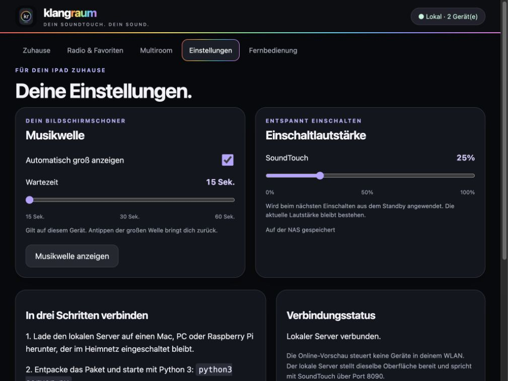
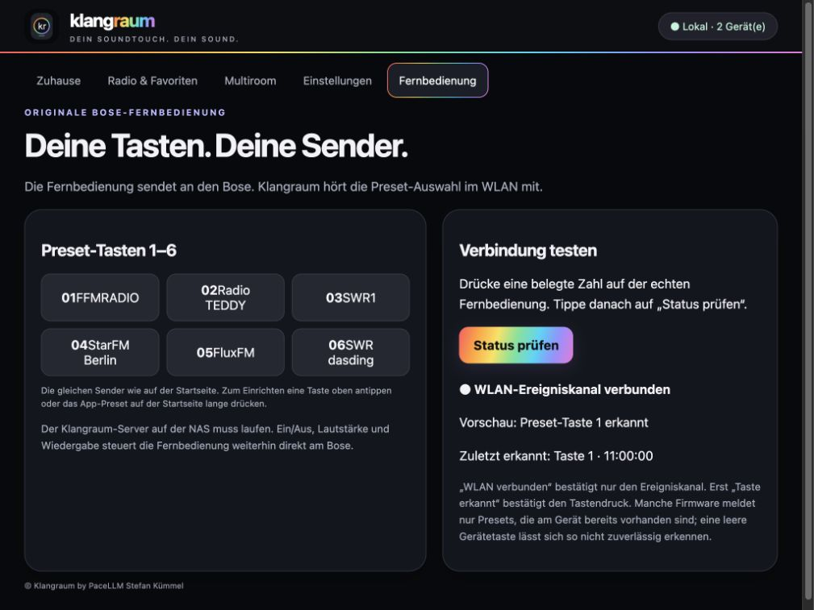

# Klangraum

**Dein SoundTouch. Dein Sound.**  
**© 2026 Klangraum by PaceLLM · Stefan Kümmel**

Klangraum ist eine lokale Web-App für Bose SoundTouch: Internetradio, sechs Lieblingssender, gemeinsame Wiedergabesteuerung und eine farbige Musikwellen-Ansicht. Die Oberfläche läuft im Browser auf iPad, iPhone oder Computer; ein eigener Server übernimmt die Verbindung zu den Lautsprechern im Heimnetz.

> **Öffentliche Projektvorstellung · Privater Quellcode · Testzugang nur nach Freigabe.**  
> Dieses Repository enthält ausschließlich Beschreibung, Bilder und Anfrageformulare. Der Programmcode wird privat verwaltet und ist hier nicht enthalten. Wenn du Klangraum testen möchtest, [stelle eine Testanfrage](https://github.com/PaceLLM/klangraum-info/issues/new?template=testanfrage.yml). Eine Anfrage erteilt noch keine Nutzungserlaubnis.

*Aktuelle Oberfläche mit horizontalen Mischpult-Schiebern, „Gerät hinzufügen“ unter „Deine Räume“ und der neuen Copyright-Fußzeile. Vorschau mit Beispieldaten.*

## Einblicke in Klangraum

<table>
<tr>
<td align="center" width="33%"><strong>Musikwellen</strong> </td>
<td align="center" width="33%"><strong>Radio & Favoriten</strong> </td>
<td align="center" width="33%"><strong>Multiroom</strong> </td>
</tr>
<tr>
<td align="center" width="33%"><strong>Einstellungen</strong> </td>
<td align="center" width="33%"><strong>Fernbedienung</strong> </td>
<td align="center">Bilder zum Vergrößern anklicken.</td>
</tr>
</table>

*Alle Aufnahmen zeigen die aktuelle Oberfläche mit Beispieldaten. Die Wellenaufnahme zeigt eine Animation, keinen Nachweis einer synchronen Audioanalyse; die Geräte- und Verbindungsangaben sind Vorschauwerte.*

## Was Klangraum kann

- **Internetradio:** Sender suchen, auswählen und als Lieblingssender speichern.
- **Sechs Presets:** kurz antippen zum Abspielen, länger drücken zum Belegen.
- **Wiedergabe:** Lieblingssender vor/zurück, Play/Pause, Stopp und Standby.
- **Retro-Mischpult:** horizontale Lautstärke- und Bass-Schieber mit Regenbogenverlauf; Bass nur bei unterstützten Geräten.
- **Lautstärke synchronisieren:** Änderungen am SoundTouch beziehungsweise seiner Fernbedienung werden in der Oberfläche nachgeführt.
- **Entspannt einschalten:** 25 % als Standard; Einschaltlautstärke in den Einstellungen änderbar.
- **Deine Räume:** zwischen SoundTouch und der lokalen Audioausgabe des geöffneten Browsers wählen. Beim Wechsel werden die anderen registrierten SoundTouch-Ausgaben gestoppt beziehungsweise in Standby versetzt.
- **Bluetooth / AirPlay:** Audioausgabe über die Systemauswahl des iPads oder iPhones hinzufügen; eine benannte Kachel merkt sich die Auswahlbezeichnung.
- **Musikwellen:** animierter Kreis und große Bildschirmschoner-Ansicht; automatische Öffnung nach 15, 30 oder 60 Sekunden, Rückkehr durch Antippen.
- **Titel und Interpret:** vorhandene Bose-, ICY- und laut.fm-Metadaten anzeigen; gespeicherte Sender werden im Hintergrund abgefragt.
- **Originalfernbedienung:** grundlegende Bedienung direkt am Bose; echte Preset-Tasten sind über eine separat eingerichtete Preset-Bridge möglich.
- **Lokaler Betrieb:** kein Klangraum-Cloud-Konto; ein geeigneter dauerhaft eingeschalteter Server genügt.

## Funktioniert das mit allen Bose SoundTouch?

**Eine vollständige Kompatibilität mit allen Modellen ist noch nicht nachgewiesen.** Klangraum nutzt die lokale SoundTouch-Web-API. Verfügbare Befehle, Radioquellen, Bassregelung und die native Tastenbelegung unterscheiden sich je nach Modell und Firmware.

| Gerätefamilie | Stand dieses Projekts |
| --- | --- |
| **SoundTouch 20** | Im privaten Pilotbetrieb erprobt: Radio, Bedienung, Lautstärkeabgleich und originale Preset-Tasten 1–6 mit gesondert eingerichteter Bridge. Die genaue Serie wurde dabei nicht separat verifiziert. |
| SoundTouch 10; SoundTouch 30; weitere Serien des SoundTouch 20 | Kandidaten für den Modelltest; keine pauschale Freigabe. |
| SoundTouch Portable; Wireless Link; SA-4 / SA-5; Wave SoundTouch | Kandidaten aufgrund der SoundTouch-Produktfamilie; Funktionen einzeln prüfen. |
| SoundTouch 120 / 130 / 220 / 300 / 520; Lifestyle / CineMate mit SoundTouch | Noch ungetestet; passende SoundTouch-Hardware beziehungsweise Adapter und Firmware erforderlich. |
| Bose SoundLink, reine Bluetooth-Boxen, Bose Smart Speaker / Smart Soundbar ohne SoundTouch | Keine direkte SoundTouch-Steuerung. Als Bluetooth-/AirPlay-Systemausgabe des Browsers gegebenenfalls nutzbar. |

Die Nennung als Kandidat ist keine Zusage für Klangraum. Die Bose-Liste kompatibler Produkte bezieht sich auf die **Bose-App**, nicht auf den Teststatus dieses Projekts. Weitere Details und ein Testablauf stehen in [docs/KOMPATIBILITAET.md](docs/KOMPATIBILITAET.md).

## Welche Hardware brauche ich?

| Bestandteil | Voraussetzung |
| --- | --- |
| Bose | Ein im Heimnetz erreichbares SoundTouch-System mit lokaler API. Bisheriger Pilot: SoundTouch 20. |
| Server | Ein eingeschalteter Mac, Windows-PC, Linux-Rechner, Raspberry Pi oder eine geeignete NAS mit **Python 3.9 oder neuer**. Der Pilot nutzt Python 3.9.2 auf Linux ARMv7. Andere Plattformen sind separat zu prüfen. |
| Netzwerk | Privates Heimnetz; Browser, Server und SoundTouch müssen einander erreichen. WLAN-Client-Isolation oder Gastnetz können die Verbindung verhindern. |
| Bediengerät | iPad, iPhone oder Computer mit aktuellem Browser. Für Safari als Home-Bildschirm-App ist vertrauenswürdiges HTTPS empfohlen. |
| Internet | Für Senderverzeichnis, Radiostreams und externe Titelinformationen erforderlich. Die Gerätesteuerung selbst arbeitet lokal. |
| Optional | Originale Bose-Fernbedienung; Bluetooth-/AirPlay-Lautsprecher als Systemausgabe des Bediengeräts. |

**NAS-Pilot:** WD My Cloud EX2 Ultra mit vorhandener Python-3-Laufzeit. Ein freigegebener Ordner allein startet keinen Server. Python, TLS, Dateirechte und Dauerbetrieb müssen auf der jeweiligen NAS geprüft werden. Ein automatischer Start nach NAS-Neustart gehört noch nicht zur geprüften Standardinstallation.

## Testzugang bei Stefan anfragen

1. Eine [Testanfrage öffnen](https://github.com/PaceLLM/klangraum-info/issues/new?template=testanfrage.yml).
2. SoundTouch-Modell, Firmware soweit bekannt, gewünschte Serverhardware und Bediengerät nennen.
3. Auf die ausdrückliche Freigabe durch **[PaceLLM / Stefan Kümmel](https://github.com/PaceLLM)** warten. Ein geöffnetes oder geschlossenes Issue allein erteilt keine Lizenz.
4. Danach die abgestimmten Schritte ausführen und die Ergebnisse im selben Issue dokumentieren.

[Ablauf einer Testfreigabe](TESTZUGANG.md): Code und Installationsanleitung werden erst nach einer individuellen Freigabe bereitgestellt.

**Issues sind öffentlich.** Keine Passwörter, privaten IP-Adressen, Geräte-IDs, Seriennummern, Kontodaten, Zertifikate oder unbereinigten Logs hochladen. Für vertrauliche Details zunächst nur um einen privaten Kontaktweg bitten.

## Wie bekomme ich Zugang?

Klangraum wird noch nicht als allgemein verfügbares Installationspaket angeboten. Nach Prüfung deiner Anfrage vereinbart **Stefan Kümmel / PaceLLM** mit dir den Testumfang, die freigegebene Version und den Zeitraum. Erst danach erhältst du auf dem vereinbarten Weg die passende Testfassung und die dazugehörige Anleitung.

Du benötigst keinen Schreibzugriff auf ein Code-Repository. Jeder Tester verwendet eigene Geräte, Netzwerkdaten und gegebenenfalls eigene lokale Zertifikate. Private NAS-Zugänge und Schlüssel des Entwicklers werden nicht weitergegeben. Weitere Einzelheiten: [TESTZUGANG.md](TESTZUGANG.md).

## Wichtige Grenzen

- **Keine akustische Liederkennung:** Titel und Interpret stammen aus Sender-/Gerätemetadaten. Fehlen diese, kann Klangraum sie nicht zuverlässig ergänzen.
- **Kein freies Bluetooth-Scanning in Safari:** Kopplung und tatsächliches Wiedergabeziel verwaltet iPadOS. Kachelnamen sind Bezeichnungen, keine Verbindungsprüfung. Bei jedem Wechsel muss die passende Systemausgabe gewählt werden.
- **Keine ferngesteuerte iPhone-Wiedergabe:** „Dieses iPhone/iPad“ meint den gerade geöffneten Browser, nicht ein beliebiges anderes Gerät im WLAN.
- **Keine globale Ausgabesperre:** Klangraum koordiniert die registrierten Bose-Geräte und seinen eigenen Browser. Andere Browserinstanzen und unabhängige Apps können parallel Ton ausgeben. Das System kann Bluetooth-Ausgaben bei Verbindungsabbruch zurück auf das iPad/iPhone umschalten.
- **Musikwellen können versetzt sein:** Auf SoundTouch läuft die zusätzliche Browseranalyse lautlos und kann gegenüber dem Lautsprecher zeitlich abweichen. Ohne verwertbares Signal bleibt eine Animation.
- **Echte Bose-Presets sind ein Zusatz:** App-Presets funktionieren nicht automatisch auf der Infrarotfernbedienung. Die native Tastenbelegung setzt eine gesondert geprüfte Einrichtung voraus; siehe eine individuell abgestimmte Anleitung nach Testfreigabe.
- Kein Spotify-Login, kein iCloud-Sync, kein DLNA-Dateibrowser und keine Zusage für alle Firmwarestände.

## Rechte und Quellcode

**© 2026 Stefan Kümmel / PaceLLM.** Dieses Informationsrepository erteilt keine Lizenz zur Klangraum-Software. Der Quellcode wird privat verwaltet. Tests und sonstige Nutzung setzen eine ausdrückliche individuelle Freigabe voraus. Weitere Hinweise stehen in [LICENSE](LICENSE).

Diese öffentliche Vorstellung ist kein Kopierschutz für bereits veröffentlichte Informationen. Für die auf GitHub bereitgestellten Beschreibungen und Bilder gelten außerdem die einschlägigen Plattformrechte und zwingenden gesetzlichen Rechte. Es handelt sich nicht um ein Open-Source-Angebot.

Klangraum ist ein unabhängiges Projekt und wird nicht von Bose entwickelt, unterstützt oder zertifiziert. Bose und SoundTouch sind Marken ihrer jeweiligen Rechteinhaber. Die optionale AfterTouch-Bridge ist ein separates Drittprojekt mit eigenen Bedingungen und hier weder als Code noch als Binärdatei enthalten.

## Quellen

- [Bose SoundTouch Web API](https://assets.bosecreative.com/m/496577402d128874/original/SoundTouch-Web-API.pdf)
- [Bose: aktueller Stand der SoundTouch-Unterstützung](https://www.bose.com/soundtouch-end-of-life)
- [Bose: Produkte der SoundTouch-App](https://support.bose.com/article/ls650-speakerht5-download-the-bose-soundtouch-app-for-compatible-products---ka08c000000hgwkaau?language=en_US)
- [AfterTouch / gesellix Bose-SoundTouch](https://github.com/gesellix/Bose-SoundTouch)

**Maintainer:** [PaceLLM · Stefan Kümmel](https://github.com/PaceLLM)
